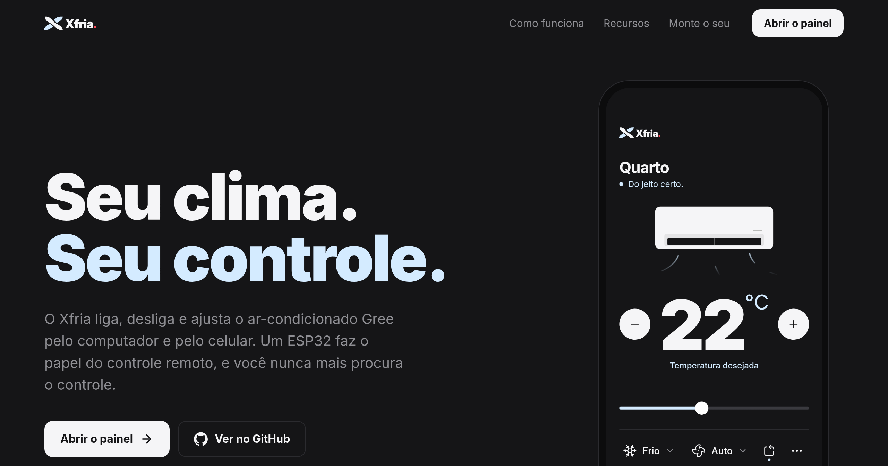
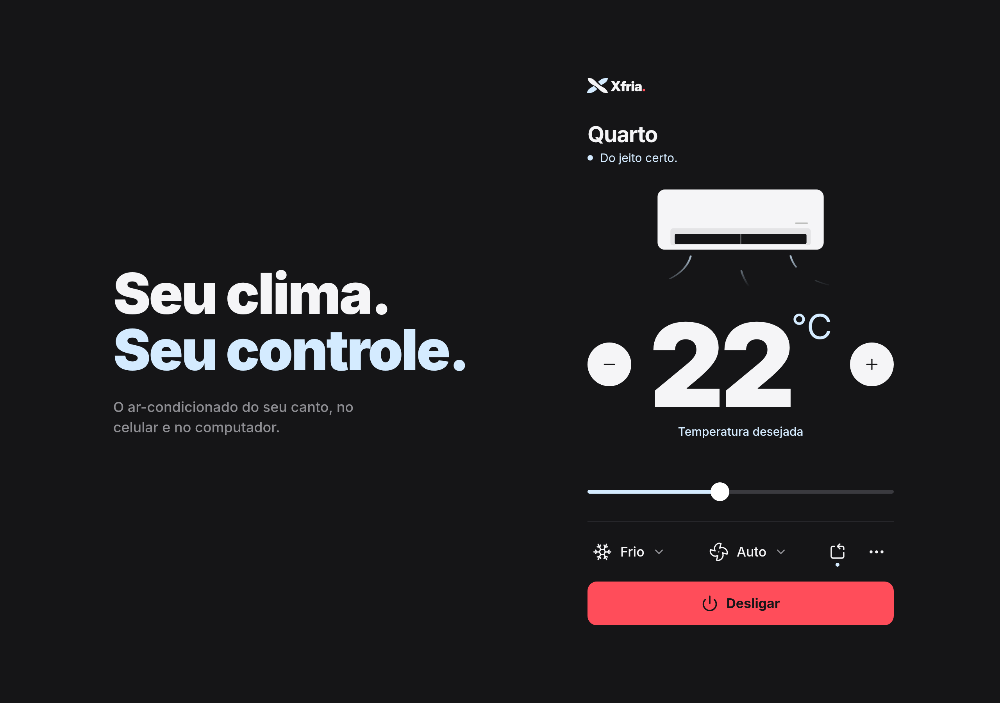

<p align="center"></p>

**Xfria** liga, desliga e ajusta um ar-condicionado Gree pelo computador e pelo celular, de qualquer lugar. Site: <https://xfria.storell.dev.br>

Um ESP32 em casa faz o papel do controle remoto infravermelho e conversa com o painel por MQTT, no plano gratuito do Adafruit IO. O painel roda no Windows, no Linux (aberto pela barra do Omarchy) e no celular como app web, e o custo mensal é R$ 0.



## Por que existe

O controle remoto some, fica no outro cômodo ou acaba a pilha, e o ar não tem Wi-Fi. Em vez de trocar o aparelho, o Xfria imita o controle original: um LED infravermelho de poucos reais, um ESP32 e um painel próprio, sem nuvem paga, sem abrir porta no roteador e sem app de fabricante.

## O que tem

- **Painel completo**: liga e desliga, temperatura de 16 a 30 °C, modo (automático, frio, desumidificar, ventilar, quente), ventilação e oscilar. No menu "•••", turbo, sono, eco, luz do display, posição da aleta e a conta do Adafruit IO.
- **No computador**: app [Tauri](https://tauri.app) que abre colado no ícone da bandeja (Windows) ou da barra (Linux), inicia com o sistema escondido e tem instalador gerado pelo GitHub Actions.
- **No celular**: o mesmo painel como app web em `/painel`; é só "Adicionar à tela inicial".
- **Barra do Omarchy**: ícone com o modo e a temperatura. Clique abre o painel, botão direito liga e desliga, rolar sobe e desce a temperatura.
- **Estado de verdade**: o ESP32 publica o estado depois de cada comando e avisa quando fica offline, então todos os painéis mostram a mesma coisa.
- **Não perde o estado**: o último estado fica na flash do ESP32 e volta depois de uma queda de energia.
- **Atualização pelo Wi-Fi**: depois da primeira gravação pelo cabo, o firmware novo vai pela rede, com senha, sem tirar a placa do lugar.
- **Caixa para imprimir**: projetos em FreeCAD, STEP e STL em `hardware/caixa/`.
- **Demonstração sem placa**: `/painel?demo` abre o painel com um ar simulado, e `bar/ar-gree simulate` finge ser o ESP32.



## Como funciona

```
Celular (de qualquer lugar)
   │  HTTPS
   ▼
App web/PWA (Vercel Hobby, grátis)      ← login, tela, botões
   │  MQTT
   ▼
Broker MQTT (Adafruit IO, grátis)  ◄── MQTT ── Plugin na barra do Omarchy
   ▲  MQTT (conexão de saída, sem abrir porta no roteador)
   │
ESP32 em casa ──IR──► Ar Gree
```

- O protocolo do Gree é decodificado pela biblioteca
  [IRremoteESP8266](https://github.com/crankyoldgit/IRremoteESP8266) (classe `IRGreeAC`).
  Cada comando envia o estado completo: liga/desliga, modo, temperatura, ventilação e swing.
- O IR é de mão única (o ar não confirma o recebimento). O sensor de temperatura mostra no
  app a temperatura real do cômodo.
- Os agendamentos rodam no próprio ESP32, com o relógio sincronizado via NTP.
- O ESP32 guarda o último estado na flash, para não perder o estado numa queda de energia.
- O MQTT vai direto do painel para o Adafruit IO por WebSocket; não existe servidor próprio.

### Tópicos MQTT (feeds do Adafruit IO)

Broker `io.adafruit.com:8883` (TLS), usuário `saulostorel`, senha = Active Key do Adafruit IO.

| Tópico | Direção | Conteúdo |
|---|---|---|
| `saulostorel/feeds/ar-quarto-set` | app → ESP32 | comando parcial, ex.: `{"power": true, "temp": 22}` |
| `saulostorel/feeds/ar-quarto-state` | ESP32 → app | `{"power", "mode", "temp", "fan", "airflow", "sleep", "eco", "turbo"}` |
| `saulostorel/feeds/ar-quarto-online` | ESP32 → app | `online` / `offline` (last will) |

O Adafruit IO não usa retain: para receber o último valor de um feed, publique qualquer coisa em
`<feed>/get`. O plano grátis aceita até 30 mensagens por minuto e 10 feeds.

Valores: `mode` = `auto`, `cool`, `dry`, `fan`, `heat`; `fan` = `auto`, `low`, `medium`, `high`;
`airflow` = `swing`, `up`, `middle`, `down`; `sleep`, `eco` e `turbo` = `true`/`false`;
`temp` = 16 a 30.

## Peças

| Peça | Status |
|---|---|
| ESP32 30 pinos USB-C + placa de expansão (terminal adapter) | comprar |
| LED IR emissor 940 nm 5 mm | comprar |
| Jumpers macho-macho | comprar |
| Kit de resistores 1/4 W (1 kΩ e 33–47 Ω) | comprar |
| Sensor de temperatura AHT20 (opcional) | decidir |
| Transistor NPN (2N2222, BC337, BC547, S8050...) | confirmar se tem em casa |
| Receptor IR KY-022 | tem (2) |
| Protoboard | tem |
| Placa Arduino (testes de IR antes do ESP32 chegar) | tem |
| Cabo USB-C de dados e carregador USB 5 V | tem |

### Ligações

| Componente | Pino | ESP32 |
|---|---|---|
| Receptor KY-022 | S (sinal) | GPIO 14 |
| Receptor KY-022 | meio (VCC) | 3V3 (nunca 5 V) |
| Receptor KY-022 | – (GND) | GND |

O emissor (LED IR + transistor, no GPIO 4) será detalhado na montagem.

## Instalação

Você vai precisar de uma conta gratuita no [Adafruit IO](https://io.adafruit.com) (com os feeds da tabela acima), do [arduino-cli](https://arduino.github.io/arduino-cli/) para o firmware e do Node.js 22 ou mais novo para o painel.

### 1. Firmware

Em `firmware/`, compilado com `arduino-cli` (versões fixadas em `sketch.yaml`):

```sh
cd firmware
cp secrets.example.h secrets.h   # preencher Wi-Fi, a chave do Adafruit IO e a senha do OTA
arduino-cli compile --profile esp32 .
arduino-cli upload --profile esp32 -p /dev/ttyUSB0 .   # só a primeira vez, pelo cabo
```

Depois da primeira gravação pelo cabo, as próximas vão pelo Wi-Fi, com o ESP32 no lugar dele:

```sh
firmware/ota-upload                  # compila e grava em ar-quarto.local
firmware/ota-upload 192.168.18.206   # ou pelo IP, se o nome .local não resolver
```

O ESP32 baixa o firmware conectando de volta no computador, na porta 32323. Com o ufw ativo, libere
essa porta para a rede de casa uma vez: `sudo ufw allow from 192.168.18.0/24 to any port 32323 proto tcp`.

Para confirmar o `kGreeModel`, grave o leitor e aperte botões do controle apontado para o receptor:

```sh
cd firmware/receptor_ir
arduino-cli compile --upload --profile esp32 -p /dev/ttyUSB0 .
arduino-cli monitor -p /dev/ttyUSB0 -c baudrate=115200
```

### 2. Painel no computador

- **Linux:** `app/install` compila e instala em `~/.local/bin/ar-gree-panel`. O clique no ícone da barra
  do Omarchy abre e fecha o painel no canto superior direito (regra de janela `ar-gree(-panel)?` em
  `~/.config/hypr/hyprland.lua`).
- **Windows:** o instalador é gerado pelo GitHub Actions (`.github/workflows/windows-installer.yml`) a cada
  push em `main` que mexa em `app/`, ou manualmente na aba Actions. Ele fica nos artefatos da execução
  (`instalador-windows`). O painel fica no ícone da bandeja; clique abre colado nele, e o menu tem "Sair".
  O app passa a iniciar com o sistema, escondido na bandeja, já na primeira vez que abre; a opção
  "Iniciar com o sistema" do menu "•••" desliga isso.

As credenciais ficam em `~/.config/ir-blaster-gree/credentials` (`AIO_USERNAME` e `AIO_KEY`, modo 600;
no Windows, em `%APPDATA%\ir-blaster-gree\credentials`). Sem esse arquivo, o painel abre na tela de configuração.

No Linux com NVIDIA, a janela é opaca de propósito: com transparência o WebKitGTK não desenha o conteúdo.
Os cantos arredondados vêm da regra do Hyprland.

### 3. Barra do Omarchy

Em `bar/`: um plugin da barra (`storell.ar-gree`) e o script `ar-gree`, que ele usa para falar com
o Adafruit IO, lendo o mesmo arquivo de credenciais do painel.

| Na barra | Ação |
|---|---|
| ícone do modo + temperatura | ar ligado |
| ícone do ar | ar desligado |
| ícone apagado | ESP32 offline |
| clique | abre/fecha o painel |
| botão direito | liga/desliga |
| rolar | sobe/desce a temperatura (enviada 0,7 s depois da última rolagem) |

```sh
bar/install                               # instala ou atualiza o plugin e reinicia a barra
omarchy plugin enable storell.ar-gree --section right

bar/ar-gree simulate                      # finge ser o ESP32, para testar sem a placa
bar/ar-gree send '{"power": true}'        # manda um comando pelo terminal
bar/ar-gree watch                         # mostra o estado em tempo real
```

### 4. Celular e site

O site é publicado na Vercel a partir de `app/` (`vercel.json`), em <https://xfria.storell.dev.br>.
A raiz é a apresentação (`app/index.html` e `app/site/`), com o painel de verdade numa demonstração com ar
simulado (`/painel?demo`, em `app/src/demo.js`). O painel em si fica em `/painel` (`app/painel.html`), que
também é a página que o Tauri abre: no celular, abra `/painel` e use "Adicionar à tela inicial"; as
credenciais ficam só naquele navegador.

## Rodando localmente

```sh
cd app
npm install
npm run dev:web             # versão do celular na rede local (porta 1420)
npm run build:web           # gera app/dist-web/
```

Para testar sem a placa, deixe `bar/ar-gree simulate` rodando num terminal: ele responde aos comandos
como o ESP32 faria. Ou abra <http://localhost:1420/painel?demo>, que não precisa nem do Adafruit IO.

## Limites

- **Só Gree**: o firmware fala o protocolo `IRGreeAC`. Outras marcas precisam de outra classe da IRremoteESP8266.
- **Um ar por placa**: cada ESP32 controla o aparelho para o qual o LED aponta, e os tópicos são de um cômodo só.
- **IR sem confirmação**: se alguém mexer no controle original, o painel não fica sabendo.
- **Plano grátis do Adafruit IO**: até 30 mensagens por minuto e 10 feeds; por isso a rolagem na barra espera
  0,7 s antes de mandar a temperatura.
- **Interface só em português.**

## Estrutura

| Arquivo | O que faz |
|---|---|
| `firmware/firmware.ino` | liga as peças: comando recebido → IR → publica o estado |
| `firmware/ac_state` | estado do ar e conversão de/para JSON |
| `firmware/gree_remote` | monta e envia o sinal IR do Gree |
| `firmware/state_store` | guarda o último estado na flash |
| `firmware/connection` | Wi-Fi, MQTT com TLS, reconexão e last will |
| `firmware/ota` | atualização do firmware pelo Wi-Fi, com senha (`ota-upload`) |
| `firmware/config.h` | pinos, modelo Gree, broker e tópicos |
| `firmware/ca_cert.h` | certificado raiz do TLS (DigiCert Global Root G2) |
| `firmware/receptor_ir/` | sketch à parte que lê o controle original e mostra o modelo Gree |
| `app/src/` | painel em HTML, CSS e JS, comum ao computador e ao celular |
| `app/src/platform/` | o que muda entre as versões: `desktop.js` (Tauri) e `web.js` (navegador), escolhido pelo modo do Vite |
| `app/src-tauri/` | janela, bandeja, credenciais e início com o sistema |
| `app/site/` | página de apresentação |
| `bar/` | plugin da barra do Omarchy e o script `ar-gree` |
| `hardware/caixa/` | caixa do ESP32 para impressão 3D |
| `marca/` | identidade visual: logos, ícones, cores e guia |

## Onde paramos

- [x] Firmware escrito (IR + Wi-Fi + MQTT).
- [x] Firmware compilando (69% da flash, 13% da RAM).
- [x] Broker: o HiveMQ acabou com o plano grátis; adotado o Adafruit IO. Login, TLS e publicação
      testados do computador.
- [x] Plugin na barra do Omarchy, testado com o simulador.
- [x] Painel desktop (Tauri) para Windows e Linux, aberto pela barra no Linux.
- [x] Instalador do Windows gerado pelo GitHub Actions.
- [x] App web/PWA para o celular (Xfria), reaproveitando o painel.
- [ ] Fechar o pedido das peças e confirmar o transistor que tem em casa.
- [ ] Quando o ESP32 chegar: ler o controle com o receptor para confirmar o modelo Gree (`kGreeModel`).

## Contribuindo

Issues e pull requests são bem-vindos. Dá para mexer no painel e no site sem ter a placa: a demonstração
e o simulador fazem o papel do ESP32.

Veja o [guia de contribuição](CONTRIBUTING.md) para o passo a passo. Para relatar uma falha de segurança, siga a [política de segurança](SECURITY.md).

## Licença

[MIT](LICENSE)
