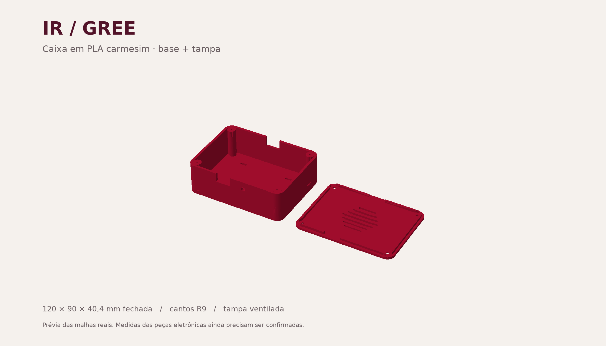

# Caixa IR / Gree — PLA carmesim

Primeira versão para a eletrônica do projeto: ESP32 com adaptador de terminais,
pequeno circuito emissor e receptor IR. **As dimensões reais dessas peças não
constam no projeto: esta versão não tem encaixe físico confirmado.** Não foi
dimensionada para acomodar também o Arduino de testes ou uma protoboard grande.

## Arquivos

- `caixa_ir_gree.FCStd`: documento FreeCAD com base e tampa separadas.
- `base.stl` e `tampa.stl`: peças em milímetros, já orientadas para impressão.
- `caixa_ir_gree.step`: intercâmbio CAD das duas peças.
- `gerar_caixa.py`: fonte ajustável; edite as constantes iniciais e regenere.
- `validacao.json`: verificações geométricas executadas na geração.

Abra o FCStd no FreeCAD e use **0** para vista axonométrica e **V, F** para
enquadrar tudo. A cor da prévia simula carmesim; a cor impressa vem do filamento.
As peças são sólidos CAD gerados, sem histórico de sketches. A planilha é uma
referência de medidas, não controla a geometria. Para mudar as dimensões, edite
o gerador e execute `python hardware/caixa/gerar_caixa.py` a partir do projeto
(usa a instalação local do FreeCAD em `/usr/lib/freecad/lib`).

## Dimensões e montagem

| Item | Medida |
|---|---|
| Caixa fechada | 120 × 90 × 40,4 mm |
| Base | 120 × 90 × 38 mm |
| Paredes, fundo e face da tampa | 2,4 mm |
| Cavidade nominal | 115,2 × 85,2 mm |
| Altura livre sob a face da tampa | 35,6 mm |
| Altura livre junto à saia da tampa | 32,6 mm |
| Cantos externos | raio de 9 mm |
| Saia da tampa | 3 mm de altura; folga de 0,3 mm por lado |
| Abertura traseira do cabo | 18 × 12 mm, aberta até a tampa |
| Janela frontal do receptor | 18 × 11 mm, aberta até a tampa |
| Furo frontal do LED | diâmetro de 5,4 mm |

As quatro torres e a saia ocupam parte da cavidade nominal. Para avaliar uma
placa retangular, use inicialmente a região central de **94 × 64 mm**, sem
invasão das torres. Inclua conectores, bornes, curvatura do cabo e jumpers nas
medidas. Componentes maiores podem exigir aumentar L/W/H no gerador.

1. Prenda a placa usando as quatro passagens de abraçadeiras no fundo. Use
   espaçadores isolantes sob a placa para que soldas e terminais não pressionem
   o fundo. Não foram presumidos furos de montagem do adaptador.
2. Posicione o LED no furo frontal e fixe-o pelo interior. O furo tem folga e
   não é um encaixe de pressão garantido. Isole os terminais do circuito.
3. Prenda o KY-022 por dentro, com a face sensível exposta pela janela frontal.
   Confira suas dimensões e alinhamento; não há berço específico para ele.
4. Passe o cabo pela abertura traseira antes de fechar. A abertura é passagem
   de cabo, não um recorte alinhado a um conector USB específico.
5. Feche com quatro parafusos autoatarraxantes de aproximadamente **2,9 × 10 mm,
   cabeça escareada**. Pilotos de 2,4 mm; passantes de 3,3 mm; escareado de
   6,2 mm a 90°. Confira a cabeça e teste um piloto antes de apertar os quatro.
   Aperte à mão sem forçar; os pilotos são cegos, com 12 mm de profundidade.

O LED e o receptor têm aberturas próprias para que o sinal infravermelho não
precise atravessar o PLA pigmentado. O AHT20 opcional pode ficar próximo às
fendas, afastado do ESP32; não foi criado um compartimento térmico separado.

## Impressão

Ponto de partida para bico de 0,4 mm: camada de 0,20 mm, 4 perímetros,
5 camadas de topo/fundo e 15–20% de preenchimento. Use o perfil e as
temperaturas indicados pelo fabricante do seu PLA.

- Base: fundo na mesa, abertura para cima.
- Tampa: face externa plana na mesa, saia para cima — o STL já vem assim.
- Suportes: projetada para dispensá-los; confira no fatiador a pequena ponte
  no furo do LED e o escareado dos parafusos.
- A textura da mesa ficará na face externa da tampa.
- Confira a escala em mm e a prévia de camadas antes de imprimir.

Antes da impressão completa, confirme o tamanho da montagem. Para calibrar
a tolerância, use um corte no fatiador com um canto da base e da tampa.
O encaixe digital foi validado com interferência zero; a folga real depende
da impressora. Evite locais muito quentes ou sol direto sobre a caixa de PLA.

## Verificação realizada

Base e tampa verificadas como sólidos válidos únicos, com malhas fechadas.
Tampa posicionada digitalmente sobre a base, sem sobreposição volumétrica.
Não houve teste de impressão, montagem física ou alcance do infravermelho.
